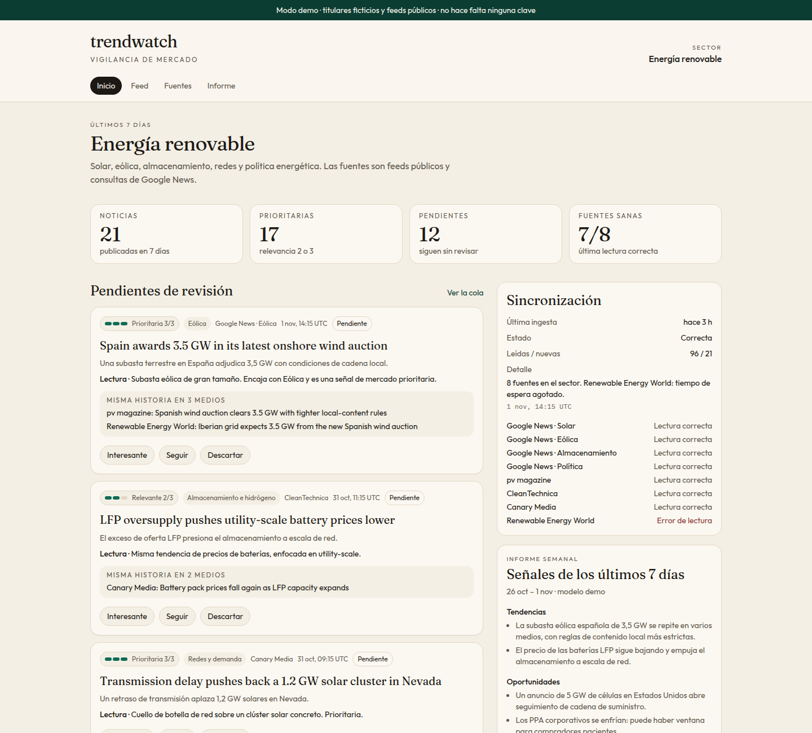
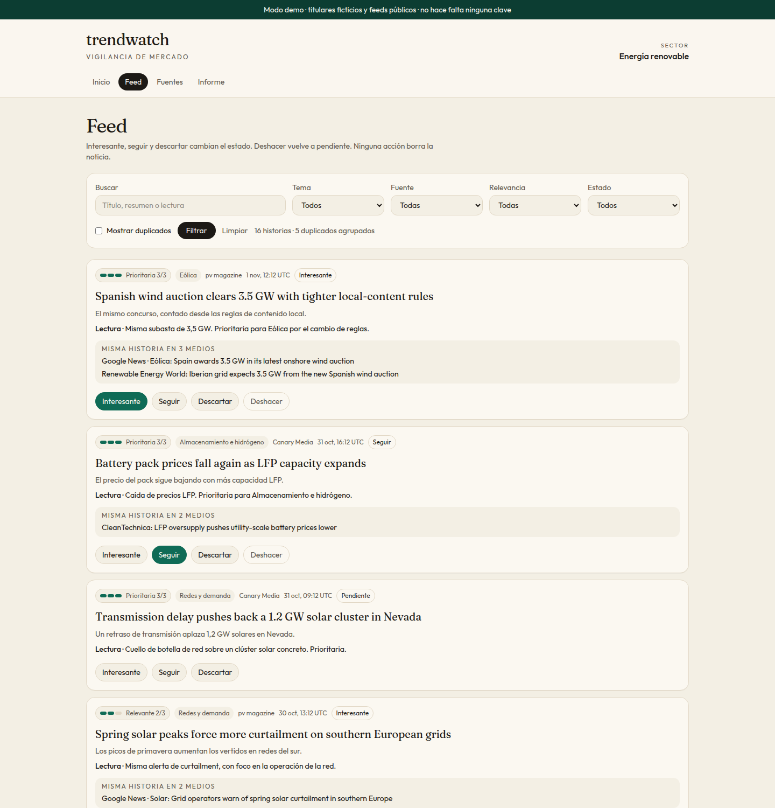
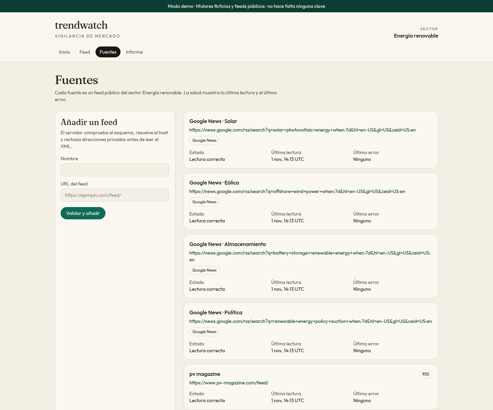
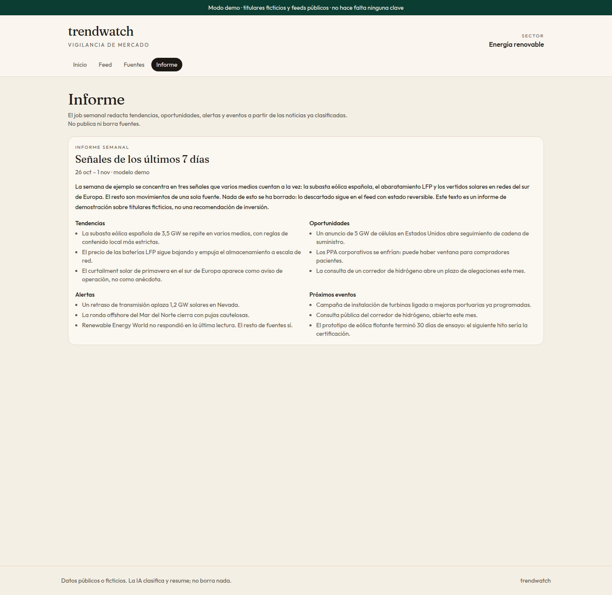
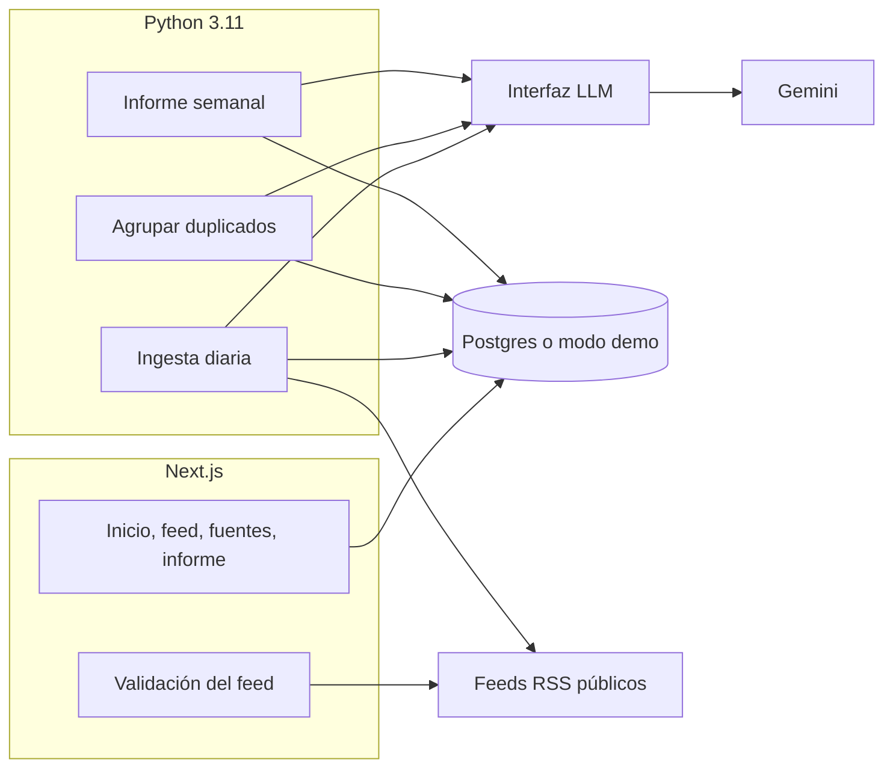
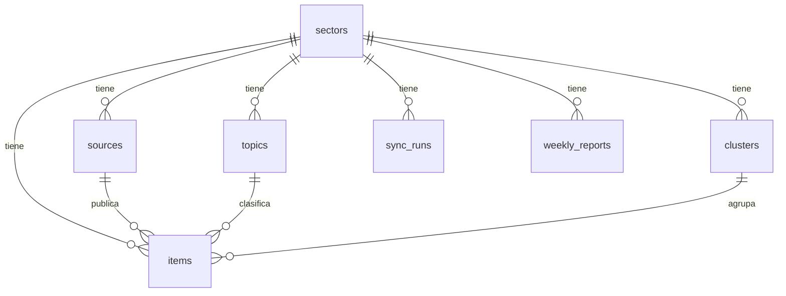

# trendwatch

**English.** Sector-scoped market watch. You configure an industry, topics and public RSS feeds. A daily job reads the feeds, asks an LLM to score each headline (relevance 0–3 plus a reason) and groups the same story across outlets. A weekly job writes a brief: trends, opportunities, alerts and upcoming events. The dashboard never deletes an item; discard is reversible. Demo mode runs with synthetic headlines and real public feed URLs, with no Supabase or Gemini keys. All stored data is public or fake.

[](https://github.com/coalva94/trendwatch/actions/workflows/ci.yml)

## Para qué sirve

trendwatch es una vigilancia de mercado por sector. El sector, los temas y las fuentes viven en datos, no en el código. El ejemplo que viene en el repo es **energía renovable**: solar, eólica, almacenamiento, redes y política, con feeds públicos reales (Google News, pv magazine, CleanTechnica, Canary Media, Renewable Energy World).

Una persona revisa la cola: marca una noticia como interesante, para seguir, o descartada. Descartar no borra. Un informe semanal resume lo ya clasificado. El modelo no publica, no contacta a nadie y no ejecuta acciones.

Hecho como proyecto de portafolio por [Carlos Alva](https://github.com/coalva94).

## Pantallas

Modo demo, sin claves.









## Arquitectura



La ingesta diaria también agrupa duplicados al final. `scripts/dedup.py` permite repetir solo ese paso. Los tests sustituyen la base y el modelo por dobles en memoria: no hace falta red ni secretos.

## Modelo de datos



| Tabla | Qué guarda |
| --- | --- |
| `sectors` | Industria activa. El slug elige cuál muestra la app. |
| `topics` | Temas y keywords. Sirven de pista al modelo y al doble de pruebas. |
| `sources` | URL pública, tipo (`rss` o `google_news`), última lectura y último error. |
| `items` | Titular, enlace, extracto, relevancia 0–3, motivo y estado de revisión. |
| `clusters` | Misma historia en varios medios. La huella sale de los tokens compartidos. |
| `sync_runs` | Cada ingesta, reagrupado o informe. |
| `weekly_reports` | Tendencias, oportunidades, alertas, eventos y una narrativa. |

El estado de una noticia es `pending`, `interesting`, `follow` o `discarded`. No hay borrado desde la interfaz. En Supabase, RLS deja leer a `anon` y `authenticated`. Un usuario autenticado solo puede cambiar el estado de revisión (un trigger impide tocar el resto de columnas). Los jobs usan la service role.

Relevancia: 0 no relacionado, 1 tangencial, 2 relevante, 3 señal prioritaria.

La migración está en `supabase/migrations/`. `supabase/seed.sql` carga el sector de ejemplo, sin titulares. Los titulares de producción los inserta la ingesta. Los del modo demo son fixtures sintéticos.

## Añadir un sector

1. Copia `data/sectors/renewable-energy.json` a `data/sectors/<slug>.json`.
2. Cambia `slug`, nombre, descripción, temas (`keywords` incluidas) y fuentes. Solo URLs `http` o `https` públicas. `kind` es `rss` o `google_news`.
3. En local, `TRENDWATCH_SECTOR_SLUG=<slug>`. En modo demo verás las fuentes y un feed vacío hasta que exista un job. El sector `renewable-energy` trae titulares de demostración.
4. Con Supabase configurado: `python scripts/seed_sector.py`. Hace upsert por slug y desactiva temas o fuentes que hayas quitado del archivo. No borra noticias.
5. El cron diario usa `TRENDWATCH_SECTOR_SLUG`. Un sector nuevo es otro archivo y otra variable, no un cambio de código.

## Arranque rápido

Hace falta Node 20.9+ y, para los jobs, Python 3.11.

```bash
cp .env.example .env.local
npm install
npm run dev
```

Abre http://localhost:3000. Con `TRENDWATCH_DEMO_MODE=true`, o sin URL y anon key de Supabase, arranca el modo demo.

```bash
npm test
npm run lint
npm run typecheck
pip install -r scripts/requirements.txt
pytest
ruff check scripts
```

Jobs, cuando existan las claves:

```bash
python scripts/seed_sector.py
python scripts/ingest.py
python scripts/dedup.py
python scripts/weekly_report.py
```

El informe semanal cubre el lunes–domingo UTC anterior. El cron está los lunes a las 07:00 UTC, después de la ingesta de las 06:00 UTC. La agrupación une titulares con bastante solapamiento de tokens normalizados y, en la zona gris, pregunta al modelo si es la misma noticia.

## Despliegue

La app es un proyecto Next.js y se despliega en Vercel. Los jobs no corren en Vercel: corren en GitHub Actions.

Secretos de Actions (`daily_sync.yml` y `weekly_report.yml`):

| Secreto | Obligatorio |
| --- | --- |
| `TRENDWATCH_SUPABASE_URL` | Sí |
| `TRENDWATCH_SUPABASE_SERVICE_ROLE_KEY` | Sí. Solo en el servidor y en Actions. |
| `TRENDWATCH_GEMINI_API_KEY` | Sí |
| `TRENDWATCH_GEMINI_MODEL` | No. Por defecto `gemini-2.5-flash`. |
| `TRENDWATCH_SECTOR_SLUG` | No. Por defecto `renewable-energy`. |

Variables en Vercel:

| Variable | Uso |
| --- | --- |
| `TRENDWATCH_DEMO_MODE` | `false` cuando Supabase esté listo |
| `TRENDWATCH_SECTOR_SLUG` | Sector visible |
| `TRENDWATCH_SUPABASE_URL` | Lectura |
| `TRENDWATCH_SUPABASE_ANON_KEY` | Lectura. Es pública por diseño; RLS limita lo que puede hacer. |
| `TRENDWATCH_SUPABASE_SERVICE_ROLE_KEY` | Guardar revisiones y fuentes nuevas. No llega al navegador. |

Gemini no hace falta en Vercel. La app no llama al modelo.

Antes del primer deploy: aplica la migración y `supabase/seed.sql`, o `python scripts/seed_sector.py`.

Al añadir un feed, el servidor solo acepta `http`/`https`, sin usuario ni contraseña, en el puerto 80 o 443. Resuelve el host y rechaza loopback, redes privadas, link-local (incluida la metadata de los cloud) y nombres como `localhost` o `*.internal`. Las redirecciones se vuelven a comprobar. Hay una ventana de DNS rebinding entre la resolución y la conexión; cerrarla fijando la IP está en la hoja de ruta.

## IA con criterio

- El modelo clasifica y redacta. No borra, no envía mensajes y no opera sobre cuentas o mercados.
- Descartar es un estado. Deshacer vuelve a pendiente.
- Coste orientativo: una llamada por noticia nueva, otra si dos titulares caen en la zona gris de duplicados, y una por informe semanal. El plan gratuito de Gemini y el de Supabase tienen cupos; si se agotan, el job falla y la fuente queda con el error a la vista.
- Puede equivocar el tema o la relevancia. La cola de revisión es humana.
- Los titulares de los medios siguen siendo de sus autores. Guardamos título, enlace y un extracto corto.
- Los titulares del modo demo son ficticios, escritos para este repo. Las URLs de las fuentes sí son feeds públicos.

## Hoja de ruta

- Embeddings opcionales para la deduplicación, detrás de la misma interfaz.
- Sesión de Supabase Auth en la interfaz, usando las políticas que ya limitan el update al estado.
- Varios sectores en la misma vista.
- Aviso cuando una alerta supera un umbral.
- Clasificación por lotes si el volumen deja pequeño el cupo gratuito.
- Fijar la IP resuelta al descargar el feed.

## Temas sugeridos en GitHub

`market-intelligence` `rss` `nextjs` `supabase` `gemini` `llm` `python` `portfolio` `renewable-energy`
