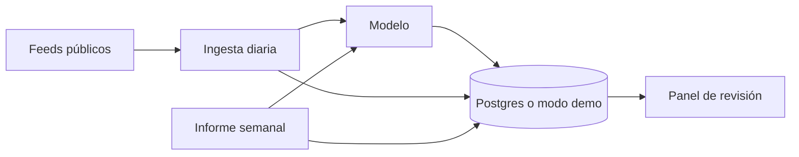

# trendwatch

**Las señales de tu sector, clasificadas cada día y resumidas cada semana.**

**English.** A market watch you configure for any industry. Public RSS feeds come in. Headlines get a relevance score and a reason, the same story is grouped across outlets, and a weekly brief lists trends, opportunities, alerts and upcoming events. People review the queue. Discard is reversible. Demo mode runs with no API keys. All stored data is public or fake.

[](https://github.com/coalva94/trendwatch/actions/workflows/ci.yml)
[](LICENSE)
[](https://nextjs.org)
[](https://supabase.com)
[](https://www.python.org)
[](https://ai.google.dev)


## El problema

Quien sigue un mercado abre varios medios, busca a mano y pega titulares en una hoja. La misma noticia aparece tres veces. Una señal de precio, de regulación o de un contrato se mezcla con lo que no cambia nada. El tiempo se va en leer, y lo importante llega tarde o no llega.

trendwatch hace esa lectura repetitiva. Trae feeds públicos del sector, puntúa cada titular y deja una cola corta para una persona. El lunes hay un informe con lo que la semana dejó.

## Para quién es

- **Pymes** que vigilan su mercado sin un equipo de research.
- **Ventas y estrategia**, que necesitan señales para una conversación, no otra pestaña abierta.
- **Consultoras** que siguen el sector de cada cliente con las mismas reglas.
- **Cualquier industria.** El sector, los temas y las fuentes viven en datos. El ejemplo del repo es energía renovable; el siguiente puede ser el tuyo.

## Qué te llevas

- 📥 **La mañana, en una cola.** Cada día se leen los feeds y cada titular llega con relevancia de 0 a 3 y un motivo.
- 🎯 **Prioridad visible.** Lo prioritario y lo relevante se distinguen de un vistazo. Lo tangencial no ocupa el mismo sitio.
- 🗂️ **Una historia, una ficha.** Si varios medios cuentan lo mismo, el panel los agrupa.
- 📅 **El lunes, un informe.** Tendencias, oportunidades, alertas y eventos de la semana, escritos a partir de lo ya clasificado.
- ↩️ **La persona decide.** Interesante, seguir o descartar. Descartar se deshace. La noticia sigue en el archivo.
- 🧩 **Tu sector, en un archivo.** Temas, palabras clave y URLs públicas van en un JSON. El ejemplo del repo es energía renovable.
- 🩺 **Fuentes con pulso.** Última lectura y último error, en la misma pantalla donde se añade un feed.
- ▶️ **Se puede enseñar ya.** El modo demo abre el panel con titulares de ejemplo y sin claves.

## El panel

Modo demo, tema oscuro. El interruptor de la barra lateral pasa a claro.


## Pruébalo en 1 minuto

Hace falta Node 20.9 o superior. No hace falta Python, Supabase ni una clave de modelo.

```bash
cp .env.example .env.local
npm install
npm run dev
```

Abre http://localhost:3000. El sector de ejemplo es energía renovable: titulares ficticios y URLs de feeds públicos reales.

Jobs, variables, otro sector y tests: [desarrollo](docs/desarrollo.md).

## Cómo funciona



La ingesta lee el RSS, pide una relevancia y un motivo, y agrupa titulares que cuentan la misma historia. El informe semanal redacta a partir de lo ya clasificado. El panel lee esos datos. En demo, los titulares de ejemplo viven en el repo y la base no hace falta.

Detalle del modelo de datos, de la seguridad de las filas y de las migraciones: [datos](docs/datos.md).

## IA con criterio

- El modelo clasifica titulares y redacta el informe. La revisión humana marca qué seguir.
- Descartar guarda un estado. Deshacer vuelve a pendiente. La noticia permanece.
- Cada noticia nueva es una llamada. Otra, si dos titulares quedan en la zona gris de duplicados. Una más, por el informe de la semana. El plan gratuito de Gemini y el de Supabase tienen cupo. Si se agota, el job falla y el error queda a la vista en la fuente.
- El tema o la relevancia pueden fallar. Por eso existe la cola.
- De cada medio se guarda título, enlace y un extracto corto. El texto sigue siendo de quien lo publicó.
- Los titulares del modo demo son ficticios, escritos para este repo. Las URLs de las fuentes sí son feeds públicos.

## Stack

| Pieza | Para qué |
| --- | --- |
| Next.js, React y Tailwind | Panel, modo demo y validación del feed al darlo de alta |
| Supabase Postgres | Sector, noticias, informes y políticas de fila |
| Python 3.11 | Ingesta diaria, duplicados e informe semanal |
| Gemini | Clasificación y redacción, detrás de una interfaz sustituible en tests |
| GitHub Actions | CI, cron diario y cron del lunes |
| Vercel | El panel. Los jobs corren en Actions |

## Hoja de ruta

- Embeddings opcionales para agrupar historias, detrás de la misma interfaz.
- Sesión de Supabase Auth en el panel, con las políticas que ya limitan el cambio al estado de revisión.
- Varios sectores en la misma vista.
- Aviso cuando una alerta pasa un umbral.
- Clasificación por lotes si el volumen se come el cupo gratuito.
- Fijar la IP resuelta al descargar un feed.

## Documentación

- [Desarrollo, tests y un sector nuevo](docs/desarrollo.md)
- [Modelo de datos y migraciones](docs/datos.md)
- [Despliegue, variables y workflows](docs/despliegue.md)

## Licencia y autor

[MIT](LICENSE). Hecho por [Carlos Alva](https://coalva94.github.io).
