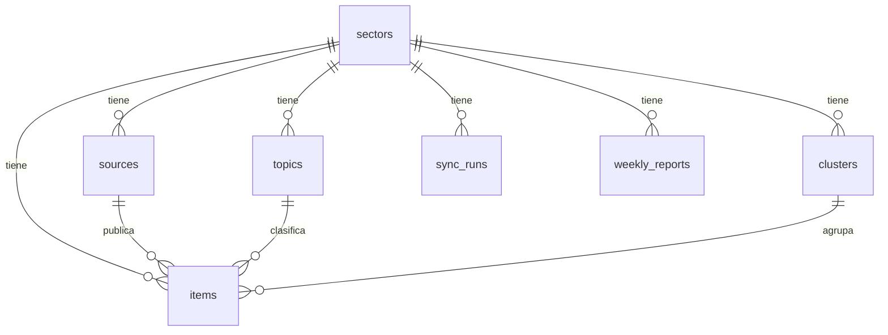

# Modelo de datos

El sector, los temas y las fuentes viven en datos. El slug activo (`TRENDWATCH_SECTOR_SLUG`) elige cuál muestra el panel.

| Tabla | Qué guarda |
| --- | --- |
| `sectors` | Industria activa. El slug elige cuál muestra la app. |
| `topics` | Temas y keywords. Sirven de pista al modelo y al doble de pruebas. |
| `sources` | URL pública, tipo (`rss` o `google_news`), última lectura y último error. |
| `items` | Titular, enlace, extracto, relevancia 0–3, motivo y estado de revisión. |
| `clusters` | Misma historia en varios medios. La huella sale de los tokens compartidos. |
| `sync_runs` | Cada ingesta, reagrupado o informe. |
| `weekly_reports` | Tendencias, oportunidades, alertas, eventos y una narrativa. |

El estado de una noticia es `pending`, `interesting`, `follow` o `discarded`. La interfaz cambia ese estado. La noticia permanece, y deshacer vuelve a `pending`.

Relevancia: 0 no relacionado, 1 tangencial, 2 relevante, 3 señal prioritaria.

## Postgres y RLS

La migración está en `supabase/migrations/`. `supabase/seed.sql` carga el sector de ejemplo, sin titulares. Los titulares de producción los inserta la ingesta. Los del modo demo son fixtures sintéticos del repo.

En Supabase, RLS deja leer a `anon` y `authenticated`. Un usuario autenticado solo puede cambiar el estado de revisión. Un trigger impide tocar el resto de columnas. Los jobs usan la service role.

Antes del primer despliegue, aplica la migración y el seed, o `python scripts/seed_sector.py`. Variables y workflows: [despliegue](despliegue.md).
